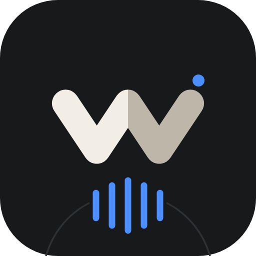

<div align="center">
  <h1>WispMusic</h1>

  
</div>

<div align="center">
  <p>简洁美观的第三方音乐客户端</p>
</div>

<div align="center">
  
  
  <a href="./LICENSE">
    
  </a>
</div>

## 功能

- 本地音乐播放与多音源插件管理
- 搜索、歌单、专辑、艺人、排行榜与 FM
- 播放队列、随机与循环模式、无缝接续
- 歌词同步、罗马音与歌词页交互
- 资料库、收藏、播放历史与音质设置
- 主题、图标包、透明度与模糊效果
- Windows 托盘、任务栏缩略图与全局快捷键

## 安装

前往 [Releases](https://github.com/9Vcc/WispMusic/releases) 页面下载最新版安装包
（`WispMusic-<版本>-setup.exe`），双击按向导安装即可。

- 系统要求：Windows 10/11 x64
- 每用户安装，不需要管理员权限
- 默认安装目录：`%LOCALAPPDATA%\Programs\WispMusic`
- 设置、插件、缓存与日志保存在安装目录下的 `wisp/`
- 音源插件不随安装包分发，可在设置页安装 `.wisp` 包
- 卸载程序保留 `wisp/` 用户数据

## 仓库结构

```text
.
├── src/
│   ├── crates/                 # Cargo workspace 成员
│   │   ├── wisp/               # 主程序入口
│   │   ├── views/              # 页面、外壳与播放器界面
│   │   ├── ui/                 # 设计系统与通用组件
│   │   ├── state/              # 应用状态与异步编排
│   │   ├── logic/              # 无 GPUI 的纯播放规则
│   │   ├── music/              # 音频引擎、解码与音源运行时
│   │   ├── storage/            # SQLite 与缓存
│   │   ├── router/             # 页面路由
│   │   ├── input/              # 文本输入与快捷键
│   │   ├── i18n/               # Fluent 本地化
│   │   ├── icons/              # 图标包注册与解析
│   │   ├── paths/              # 数据目录与迁移
│   │   ├── cli/                # 命令行参数与补全
│   │   ├── webview/            # 原生登录浏览器
│   │   ├── wisp-plugin-api/    # 插件协议
│   │   ├── wisp-plugin-host/   # Wasm 插件宿主
│   │   ├── wisp-plugin-pack/   # .wisp 包格式与安装
│   │   └── embed/              # 构建期资源嵌入
│   ├── assets/
│   │   ├── fonts/              # 内嵌字体与字体许可
│   │   ├── icons/              # Lucide、Iconoir、Material、MingCute、Phosphor、Remix、Solar、Tabler
│   │   ├── i18n/               # en-US 与 zh-CN Fluent 文案
│   │   ├── themes/             # Wisp、Catppuccin、Gruvbox 等主题
│   │   ├── windows/            # Windows 图标与资源
│   │   ├── macos/              # macOS 图标与资源
│   │   ├── linux/              # Linux 图标与资源
│   │   └── tray/               # 托盘图标
│   └── vendor/                 # vendored 依赖，如 soundtouch-rs
├── xtask/                      # 构建与安装包任务
├── installer/                  # NSIS 安装脚本
├── scripts/                    # 维护与自动化脚本
├── tools/                      # PE 检查等 Windows 工具
└── .github/workflows/           # CI 与维护工作流
```

### Crate 职责

| Crate | 职责 |
| --- | --- |
| `wisp` | 主程序入口、窗口、托盘、任务栏缩略图、生命周期 |
| `views` | 页面、全屏/桌面外壳、播放条、歌词与共享界面 |
| `ui` | 主题、度量、通用组件、着色器与无障碍基础 |
| `state` | GPUI 实体、设置、资料库、会话、播放控制与异步任务 |
| `logic` | 队列顺序、FM 规则与歌词聚合等纯逻辑 |
| `music` | 播放引擎、流式读取、解码、DSP、provider 协议与内置音源 |
| `storage` | `state.sqlite`、缓存数据库、schema 与连接管理 |
| `router` | 页面目标、导航历史与链接抽象 |
| `input` | 文本输入元素、全局动作与快捷键 |
| `i18n` | Fluent 宏、语言选择与内嵌 `.ftl` 资源 |
| `icons` | 图标包注册、当前图标包与资源路径解析 |
| `paths` | 可执行文件相邻数据目录、平台目录与旧数据迁移 |
| `cli` | 参数解析、本地/远程控制命令与 shell 补全 |
| `webview` | 使用独立临时会话的原生登录浏览器 |
| `wisp-plugin-api` | 面向 WASM 目标的版本化插件协议 |
| `wisp-plugin-host` | Wasmtime 加载、host imports、HTTP 与凭据代理 |
| `wisp-plugin-pack` | `.wisp` 容器、签名校验与插件安装 |
| `embed` | 构建脚本使用的目录扫描与 `include_bytes!` 生成器 |

## 技术栈

| 层次 | 技术 |
| --- | --- |
| 语言与构建 | Rust 2024、Cargo workspace、xtask |
| 界面 | GPUI（Sonora GPUI fork）、原生渲染、SVG 与着色器 |
| 异步与状态 | Tokio、GPUI Entity/Observer、`anyhow` |
| 网络 | reqwest、rustls/ring、tokio-tungstenite |
| 音频 | Rodio、CPAL、Symphonia、rusty_aac、rtrb |
| DSP 与重采样 | rustfft/realfft、SoundTouch、自研音频处理链 |
| 存储 | SQLite（rusqlite bundled）、serde、Moka 缓存 |
| 插件 | Wasmtime + Cranelift、`.wisp` 包、WASM host API |
| 平台集成 | Windows API、WebView2、托盘、MPRIS/zbus、ALSA/PulseAudio |
| 资源与本地化 | Fluent、resvg、image、构建期内嵌资源 |
| 打包 | NSIS 每用户安装包、Windows 静态 CRT |
| 质量工具 | rustfmt、Clippy、`cargo test` |

## 开发

### 环境要求

- Windows 10/11 x64
- 支持 Rust 2024 的稳定版 Rust 工具链
- Visual Studio Build Tools（MSVC）与 Windows SDK
- 构建安装包时需要 NSIS 3.x，并确保 `makensis` 在 `PATH` 中

主程序的运行、检查与测试不需要 Node.js。

### 常用命令

以下命令均在仓库根目录执行：

| 命令 | 用途 |
| --- | --- |
| `cargo run` | 编译并运行调试版 |
| `cargo run --release` | 编译并运行优化版 |
| `cargo fmt --all` | 格式化整个 workspace |
| `cargo fmt --all -- --check` | 检查格式，不修改文件 |
| `cargo check --workspace` | 类型检查整个 workspace |
| `cargo test --workspace` | 运行整个 workspace 的测试 |
| `cargo clippy --workspace --all-targets` | 运行 Clippy 静态检查 |
| `cargo build-installer` | 一条命令完成 release 构建、暂存与 NSIS 打包 |

安装包产物位于 `target/installer/WispMusic-<版本>-setup.exe`。

### 开发约定

- `logic` 与 `music` 不依赖 GPUI；界面状态统一放在 `state`。
- 网络与阻塞任务通过 Tokio 运行，UI 更新回到 GPUI 实体。
- 用户可见文案统一放入 `src/assets/i18n/`，使用 Fluent。
- 字体、图标、主题与文案在构建期嵌入，不依赖运行时外部资源。
- 新增音源优先实现 `wisp-plugin-api` 协议，不把 provider 细节泄漏到界面层。
- 提交信息使用 Conventional Commits，例如 `feat(player): ...` 或 `fix(state): ...`。

## 项目来源

WispMusic 的播放内核基于 [Sonora](https://github.com/sonorahq/sonora)，界面与播放器能力在本项目中持续演进。
项目使用 [GPUI](https://github.com/zed-industries/zed) 构建原生界面，并保留 Sonora 的音频与播放架构基础。

感谢以下项目：

- [Sonora](https://github.com/sonorahq/sonora)
- [GPUI](https://github.com/zed-industries/zed)
- [Symphonia](https://github.com/pdeljanov/Symphonia)
- [Rodio](https://github.com/RustAudio/rodio)
- [EchoMusic](https://github.com/hoowhoami/EchoMusic)

第三方版权与许可清单见 [THIRD-PARTY.md](./THIRD-PARTY.md)。

## 声明与许可

### 本项目许可

除非文件另有说明，WispMusic 自有代码版权所有 (C) 2026 9Vcc 及 WispMusic 贡献者，按
[GNU Affero General Public License v3.0 or later](./LICENSE) 授权。

WispMusic 的播放内核基于 Sonora。Sonora 派生部分继续受 GNU GPL v3.0 or later 约束；本项目将合并作品按
AGPL-3.0 or later 分发。GPL-3.0 第 13 条允许这种组合许可方式，GPL 全文见 [COPYING](./COPYING)。
上游版权与许可说明按 [THIRD-PARTY.md](./THIRD-PARTY.md) 保留。

### 再分发义务

分发本程序的源代码或二进制文件时，应当：

1. 保留版权、许可与修改声明，不得删除 `LICENSE`、`COPYING`、`THIRD-PARTY.md` 及资源目录中的许可文件。
2. 同时提供对应版本的完整源代码，或明确给出获取途径；本仓库与 `Cargo.lock` 固定了依赖版本。
3. 对修改版本标注修改内容与日期，不得以原项目名义误导性发布。
4. 若将修改版本作为网络服务提供给用户，应按 AGPL-3.0 第 13 条向服务使用者提供对应源代码。
5. 不得在 AGPL/GPL 授予的权利之外增加限制性条款。

### 第三方组件与资源

第三方组件遵循各自许可证，包括 MIT、Apache-2.0、BSD、ISC、MPL-2.0、CC0、CC BY 4.0、SIL OFL 等。
完整 crate 清单、版权声明与许可全文见 [THIRD-PARTY.md](./THIRD-PARTY.md)。

内嵌字体与图标包括 Inter、阿里巴巴普惠体 3.0、Lucide、Iconoir、Material Symbols、MingCute、
Phosphor、Remix Icon、Solar Icon Set、Simple Icons 与 Tabler Icons；使用或再分发时应遵守其对应许可。

### 内容、商标与免责声明

音乐内容、封面、歌词、商标与服务账号版权归各原权利人所有。本项目不隶属于相关音乐服务商，
也不授予任何音乐内容或商标的使用权；使用者应自行取得必要授权并遵守当地法律。

本程序按“现状”提供，不提供任何明示或暗示担保，包括适销性、特定用途适用性与不侵权担保。
许可义务以 [LICENSE](./LICENSE) 与 [COPYING](./COPYING) 全文为准。
